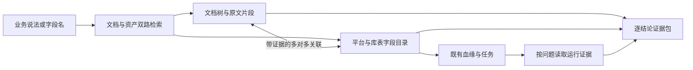

# 字段发现、双向索引与排障：面向复杂数据平台的增量研究

整理日期：2026-10-22 至 2026-10-23（Asia/Shanghai）。执行：科研台项目内 deep-survey；Codex 公开资料核查与设计，自审。没有运行科研台内模型，没有接入企业平台。本轮是沿既有调研补齐“用户不知道去哪里找”的专题，不是重新做方法排行榜。

## 1. 最新需求与优先级

用户补充：Confluence 保存维护、采集、清洗等多类文档，层级复杂；数据库结构对使用者不透明。用户希望从任一系统找到另一个系统中的对应内容，并帮助排查不规范和异常。用户明天可补充背景；不能要求用户先理解全部数据库或人工建全量字段字典。

推荐第一交付是“业务问题 → 可使用的数据对象 → 对应规则和来源”的搜索入口。其次是从表/字段反查采集、清洗、维护说明；第三步才是带运行证据的排障。RAG 负责组织检索与解释，底座需要可检索目录、对象消歧及有来源的关联。

成功结果不只是回答一段话：应交付具体字段路径、适用口径、候选差异、原文位置，以及还没查清的内容。数据库的记录数很大，不意味着解释字段必须读取所有记录；但字段目录本身也可能很大，仍需分页与范围控制。

## 2. 本轮核查的依据

| ID | 资料与核查深度 | 支持的判断及边界 |
|---|---|---|
| D1 | [Confluence Cloud Descendants](https://developer.atlassian.com/cloud/confluence/rest/v2/api-group-descendants/)，页面 descendants 正文 | 可按深度与游标遍历内容树；返回最小元数据，正文需另取。文档树里的 Database 是 Confluence 内容类型，不等于企业数据库。 |
| D2 | [Confluence Data Center 页面/子页 API 示例](https://support.atlassian.com/confluence/kb/how-to-get-page-content-or-child-list-via-rest-api/)，官方说明 | Data Center 有对应读取方式；实际部署版本尚未知，不能照搬 Cloud 端点。 |
| D3 | [DataHub Context Documents](https://docs.datahub.com/docs/features/feature-guides/context/context-documents)，关联资产与导入相关正文 | 文档可关联数据资产；Confluence 导入是单向，External 模式保留源链接。双向查询不要求双向写回。Ask DataHub 的 Cloud 范围需单独考虑。 |
| D4 | [DataHub MCP Server](https://docs.datahub.com/docs/features/feature-guides/mcp)，只读工具段 | 提供字段分页筛选、元数据及血缘查询的工具形态参考；不是已接入用户平台，也不能推断缺失的元数据会自动补齐。 |
| D5 | [DataHub Confluence source](https://docs.datahub.com/docs/generated/ingestion/sources/confluence)，能力、限制与配置段 | 文档标 Alpha/Cloud private beta，并限制 Remote Executor；还存在文档/页面数量限制及片段截断行为。应核实目标版本与部署可用性。 |
| D6 | [Aurum，ICDE 2018](https://raulcastrofernandez.com/papers/icde18-aurum.pdf)，摘要与引言 | 数据发现、关系导航有独立研究基础；其数据画像/签名路线涉及读取数据，不能直接当成本方案的免扫描能力。未复现。 |

来源台账：[discovery-sources.json](discovery-sources.json)。DataHub 页面版本标记为 1.7.0，为动态文档，未固定源码提交；不能保证用户将来安装版本与之相同。Data Center 的版本化 descendant API 页本次正文提取不完整，使用官方 KB 支撑最小判断。

## 3. 保留多套层级，用有类型的关联连接

文档树与数据目录并不是同一棵树。一篇清洗规则可适用于多个字段；一个字段可同时依赖采集说明、业务定义、例外章节和维护记录。业务域、文档父子结构、物理库表结构与运行血缘应分别保存。

这是拟议架构，不是已部署拓扑。章节属于某个目录，只能作为定位线索，不能据此宣布规则适用于全部子页面或同名字段。例如父页“订单业务”不证明其下每个 amount 都表示支付金额。

需要区分的关联：`mentions`（提到对象）、`defines`（定义含义）、`specifies_rule`（规定规则）、`implements`（任务实现）、`derived_from`（数据依赖）、`supersedes`（替代规则）。上述名称是本方案的内部关系类型，不是声称企业 API 已有这些字段。`mentions` 不可直接升级为 `defines`；`defines` 也不能证明某次运行执行了规则。

## 4. 如何自动建立双向索引

### 4.1 建立两份可分页的目录

- 文档侧：源站点/空间/页面原生 ID、父节点、内容类型、版本、正文段落/表格位置、显式链接与访问范围。目录路径单独存，不把路径当永久身份。页面移动要使路径相关检索上下文失效。
- 数据侧：先复用现有平台或血缘的资产目录；读取实例、环境、库/schema、表/视图、列及嵌套字段路径、类型、注释、现有资产链接和任务引用。不要猜平台名称背后的引擎。
- 没有稳定字段 ID 时，使用带实例和父对象的字段路径作当前版本定位，并保存重命名待核查记录；不能因新旧字段相似就宣称是同一对象。

初始以目录枚举和文档解析为主。数据抽样、统计及 SQL 执行仅在某个问题确实需要且接入条件已明确时进行；不把全库数据画像作为上线前提。

### 4.2 从明确引用到候选匹配

1. 解析现有资产 URL/ID、任务输入输出、带范围的库表字段全名，优先查目录验证是否存在。
2. 从表格行提取字段名、说明、表头、页内适用范围及例外。保持行列对应；不能把相邻行的说明拼到目标字段上。
3. 对中文业务词、缩写、旧名、局部字段名生成候选。按权限、实例/环境与可核实业务范围缩小候选；只有文档目录暗示的域应作软排序，不能硬过滤掉跨域规则。
4. 用名称、字段类型、父表、规则适用范围和显式引用核对候选。模型生成解释只能用于排序/候选，最终映射仍需原文支持。
5. 输出已核查、待消歧、冲突、过期四类关联；同名字段并列比较，必要时只问一个有区分度的问题，例如“你要订单明细还是按天汇总的数据？”

不做每篇文档与每个字段的全组合比对。采用倒排命中、范围筛选和有界语义候选，再验证少量关联。成本记录目录量、解析片段量、候选对数、核验调用数及变更重处理量；不要用数据库行数直接估算全部 RAG 成本。

### 4.3 同一条关联，支持两个查询方向

保存一条关联记录，并分别建立 `asset_ref → relation_ids` 和 `source_fragment_ref → relation_ids` 的索引。两边引用同一个 relation ID 与版本，避免维护两套会漂移的答案。

关联记录需包含对象、关系类型、支持片段、源版本、适用范围/时间、提取方式、审核状态及失效依赖。文档更新时旧关联退出“当前有效”查询；新版本重新核验。历史证据是否保留服从权限与保留规则。

这里的“双向”指从字段查文档、从文档查字段。不需要自动修改 Confluence，也不意味着文档中的关系一定已由血缘系统证实。

## 5. 索引成功还要知道覆盖了哪里

新增拟议 coverage 记录：范围、枚举 cursor、是否走完分页、发现/读取/解析/索引成功数量、失败对象、未解析区域、截断原因、源版本、最后成功时间。未扫描或无权限的范围记为 unknown，而不是 0 个对象。

D5 中 `chunking.max_chunks_per_document` 描述超过片段上限时截断嵌入，只报告 warning。由此得到工程建议：分别追踪原文读取覆盖、结构解析覆盖和检索索引覆盖。只读到了页面，不代表页尾字段说明已进入检索。

对巨大文档可采用章节/表格分区检索与原文回取；不能仅提高 top-k 期待找回根本没有建立索引的内容。如果导入范围、目录深度或页面分页未走完，输出“当前覆盖范围内未找到”；不要输出“没有定义此字段”。

适用性注意：官方连接器的内容抽取能力描述不能代替本地宏、附件、合并单元格、中文切词与超长字段表的验收。导入权限也不能直接推断为最终用户权限透传。

## 6. 用户实际看到的三个入口

| 入口 | 应返回的结果 | 下一步操作 |
|---|---|---|
| 我想找“实际到账金额” | 若干字段候选，显示具体平台/环境/库表字段路径、明细或汇总粒度、单位/口径（有依据才显示）、命中原因和来源 | 比较候选，打开真实对象或说明原文 |
| 我有一个表/字段，不知道怎么用 | 定义、采集来源、清洗规则、适用例外、现有血缘及各自版本 | 逐项展开原文，沿有证据的关系继续查 |
| 这个值为什么不对 | 本次对象/时间/分区范围，已观测到的规则和运行状态、假设与待查步骤 | 按优先级查任务/水位/上游，输出可复查证据包 |

界面建议采用搜索结果列表 + 对象详情 + 可展开证据路径。复杂图默认只展示与当前问题相关的一条路径及分支，不把全企业关系图作为首页。聊天用于细化问题，资产卡片和原文用于核查。此处是产品设计建议，本轮未改 UI。

## 7. 排障如何避免把猜测写成根因

先固定“哪个对象、何时、什么异常、预期依据”。例如“昨天金额不对”仍缺少数据日期、观察时间、业务口径和对象；系统先通过候选与上下文补齐，不能擅自执行大范围 SQL。

| 发现 | 可以说什么 | 还不能说什么／缺少什么 |
|---|---|---|
| 文档字段未链接目录 | 存在待定位说明或目录覆盖缺口 | 不能直接判定表已删除；还需版本、范围和可见性核对 |
| 同名字段出现在不同库 | 有歧义候选 | 不能直接判重复、不规范或应该合并 |
| 两份定义单位不同 | 可能存在口径差异 | 需确认同一对象、同一适用期及转换环节，才能判冲突 |
| 当前任务 SQL 没有某过滤 | 本段实现没有显式过滤 | 不能直接判清洗错误；可能上游已处理 |
| 目标运行失败或输入水位落后 | 有已观测的运行异常 | 不能单凭这一点证明用户看到的错值由它造成 |
| 目录或导入有截断 | 当前检索覆盖不完整 | 不能断言原始文档没有规则 |

“建议排查顺序”与“已确认根因”分开展示。跨系统只得到部分链路时，输出已知路径、各节点时间和缺口；不宣称穷尽所有上下游。疑似规范问题进入有证据的治理清单，附具体规则依据、适用范围和验证动作；没有规范依据就记为候选改进，而不是违规。

## 8. 与前沿 RAG 方法的衔接

沿用既有 [方法比较](frontier-rag-methods.md)，本轮不增加未经核对的性能排名。

- 上下文检索：补足字段表头、文档父章节、对象范围；父章节用于找线索，是否继承规则另需证据。
- 查询时图扩展：在文档、字段、任务与既有血缘之间补齐路径；先分辨关系类型，再判断能否支持结论。
- 多轮工具检索：当“定义已找到但实现未知”时决定下一次读取哪个源；不让简单字段查找也进入多轮循环。
- 证据筛选：检查组合片段的对象、时间、粒度、单位是否兼容；冲突材料要保留给用户查看。

研究空白更具体了：在不依赖全库扫描和人工全量映射的条件下，自动连接文档结构与字段目录，并对误关联、覆盖不足和更新失效给出可检验边界。它是本项目待验证问题，不是已证明的新颖算法。

## 9. 最小评测：先验证是否找对、能否反查

新增 [discovery-evaluation-cases.json](discovery-evaluation-cases.json)，含 12 项尚未运行的验收设计，没有模拟通过结果。它与现有 12 项语义证据验收互补。

拟议对照：A 文档混合检索；B 文档和资产目录双路检索；C B + 有证据的双向关联；D C + 查询时血缘/运行取证。相同授权、语料快照与证据预算。界面易用性另做用户任务测量，不与算法召回混为一谈。

指标：候选字段 Recall@k（按金标准可接受对象集合）、唯一对象准确率与拒绝消歧比例、跨系统关联 precision/recall（按关系类型）、双向索引一致性、必要证据覆盖、异常误报、首次找到可用对象的耗时和成本。目录范围未知时不报告“全库覆盖率”。

可证伪假设：
1. 双路检索减少“文档说对了但找不到可用字段”的失败；若在固定预算下没有改善，应先定位目录覆盖或别名问题。
2. 保留结构上下文提高字段行绑定准确率；若只是靠多读文本改善，需要等量上下文消融。
3. 引入 coverage 信息降低把缺索引误判成缺规则的比例；同时报告拒答，不能靠全部输出未知取得好看数字。

## 10. 明天补充背景的最小材料

不需要讲清全平台。选一个曾经找不到字段或排查很久的问题，按以下顺序描述即可：

1. 当时想找/核对什么；现在通常从哪个页面开始，卡在哪里。
2. 一段脱敏的 Confluence 目录路径和有关原文，保留字段名与表头对应；不知道哪页相关也如实记录。
3. 数据平台里能看到的对象路径/页面功能，以及能否看到 schema、SQL、血缘、运行记录；不确定产品准确名字可先记“未知”。

这些材料能决定首个试点的输入输出。接口、账号与全库规模留到选定试点后核实。10 月 23 日 01:46 自动任务应先读取此文和 TASK.md，避免继续泛泛罗列 RAG 论文。

## 本轮状态

已完成：上述公开能力核查、双向关联设计、覆盖与排障边界、试点验收设计及来源台账。没有新增真实数据实验、连接器实现或科研台模型执行。下一步是用一个脱敏真实问题验证对象定位与原文关联，之后再决定是否需要复杂图检索。
